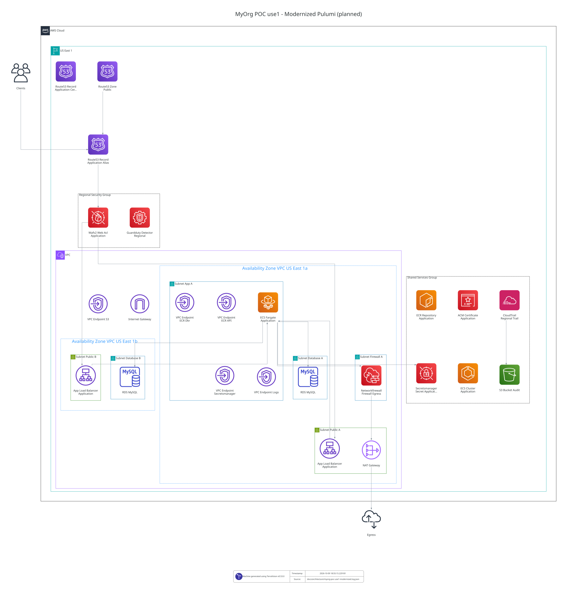

# AWS Terraform to Pulumi Example — modernized Pulumi target

This example uses a fictional organization called MyOrg. The three branches demonstrate infrastructure adoption, hardening, and modernization; they are not evidence of a deployed environment.

This branch describes the third stage of the MyOrg PCI-DSS network-control
exercise: a **Pulumi TypeScript** AWS platform with an application container on
**ECS/Fargate** and **MySQL on Multi-AZ RDS**. The implementation contract for
the original network-control exercise is
[`docs/01_architecture.md`](docs/01_architecture.md); the implementation and
operational boundaries of this branch are in
[`docs/04_modernized_pulumi.md`](docs/04_modernized_pulumi.md).

## Reviewer Quick Path

This repository is intentionally organized as three stages of the same infrastructure exercise.

The branches are not competing versions of the same answer. Each branch answers a different engineering question while preserving the decisions made at the previous stage where appropriate.

| Branch | Purpose | Primary review question |
|---|---|---|
| `main` | Canonical brownfield scenario implementation | Can the existing AWS CLI-created environment be adopted into controlled Terraform management without unnecessary redesign? |
| `audit-hardening` | Production/security hardening | How should the baseline evolve when database resilience, encryption, WAF, GuardDuty, backups, and additional operational controls are required? |
| `modernized-pulumi` | Modern target architecture | How could the application platform be redesigned around Pulumi, reusable components, ECS/Fargate, and managed services without hiding migration or ownership changes? |

`main` deliberately retains the existing EC2-hosted MySQL deployment rather than turning the scenario into an unrequested database migration.

The RDS migration and additional production hardening begin in `audit-hardening`.

`modernized-pulumi` is a separate modernization exercise. It demonstrates the target application architecture without silently performing destructive migration steps such as retiring the existing database, moving DNS, removing Terraform state, or automatically running `pulumi up`.

For agent-assisted or automated review, start with [`AGENTS.md`](./AGENTS.md). It documents the branch contract, scope boundaries, evidence model, verification rules, and known deployment limitations.

For each requirement, review the repository using the following evidence chain:

**requirement → architectural decision → implementation → configuration → verification → limitation**

The branch-specific README and documentation describe the implementation present in that branch. Verification claims should be treated as valid only where the corresponding command was actually executed successfully.

## Branch evolution

| Branch | Infrastructure | Purpose |
| --- | --- | --- |
| `main` | Terraform, manually seeded VPC/EC2 adoption, MySQL on EC2, ALB, Network Firewall | Minimum PCI-DSS 1.3.1/1.3.2 network-control POC |
| `audit-hardening` | Terraform plus private Multi-AZ RDS, WAF, GuardDuty, backups and reviewed MySQL cutover | Hardening and database migration |
| **`modernized-pulumi`** | **Pulumi TypeScript, ECS/Fargate application, RDS and AWS security services** | Separate modernized target implementation |

The three READMEs describe **their respective branch**, not identical
deployments. Source code and checked-in diagrams are **not** evidence that any
resource has actually been applied in an AWS account.

## Ownership and repository layout

The active modernized program is declared at
`deployments/myorg/poc/use1/pulumi/Pulumi.yaml`. Its `main` entrypoint is
`modules/pulumi/platform/index.ts`, which composes reusable components:

```text
modules/pulumi/
├── platform/                 # composition and typed YAML loading
├── vpc/                      # dedicated VPC, subnets, routes
├── firewall/                 # AWS Network Firewall, NAT, egress routing
├── security/                 # ALB, app, RDS and endpoint security groups
├── logging/                  # CloudTrail, VPC Flow Logs, audit bucket
├── route53/ and acm/         # public DNS and HTTPS certificate
├── rds/                      # encrypted Multi-AZ MySQL
├── iam/                      # ECS task/execution identities
├── ecs/                      # ECR, Fargate, ALB and AWS endpoints
├── waf/ and guardduty/       # application and regional protection
├── package.json
└── package-lock.json

deployments/myorg/poc/use1/
├── location.yml              # region: us-east-1
├── pulumi/
│   ├── Pulumi.yaml
│   └── config/                # one YAML per platform concern
└── ...                       # 12 retained, independent Terraform roots

containers/myorg/poc/use1/application/
├── Dockerfile
├── app.py                     # synthetic fixture, NOT the customer application
└── entrypoint.sh              # runtime-only artifact retrieval
```

The Pulumi program reads its location from
`deployments/myorg/poc/use1/location.yml`, not from a second region YAML in
the Pulumi `config/` directory. The `aws:region` Pulumi provider setting must
match that location; the program explicitly checks for `us-east-1`.

The Terraform roots, their modules, their CI workflow and their independent S3
states remain in this repository to document the **previous two stages**.
They are **not Pulumi dependencies**. The Pulumi program creates a separately
named platform (`myorg-poc-use1-modern`); it does **not** import the existing
Terraform state, migrate existing AWS resource ownership, copy MySQL data,
switch production DNS, or retire EC2/DLM. Never operate Terraform and Pulumi
as competing owners of the same live AWS objects.

## Modernized target and current limitations

The declared platform includes:

- a new custom VPC with public ALB subnets, a private application subnet,
  isolated database subnets in two AZs, and controlled Network Firewall/NAT
  application egress;
- an HTTPS ALB with an approved-client allowlist, regional WAF, Route 53, and
  ACM certificate handling;
- a Fargate service, private ECR/CloudWatch/Secrets Manager access, an S3
  gateway endpoint, and ECS task identities;
- private MySQL 8.4 Multi-AZ RDS with encryption, backups, deletion
  protection, and a separately populated application credential secret;
- CloudTrail, VPC Flow Logs, audit S3, firewall logs, and GuardDuty.

**This is a review target, not a completed cutover.** The checked-in
`desired_count: 0` prevents application tasks from starting by default, but a
first `pulumi up` still creates chargeable RDS, firewall, NAT, ALB, endpoints,
audit and security resources. The application is single-AZ and the checked-in
`app.py` only tests TCP database reachability, not SQL authentication, customer
workload behavior or data parity. The ECS task receives
`MYORG_APP_PORT` from `config/application.yml`; the fixture requires it at
startup, so the runtime listen port matches the ALB and task definition.

The application container retrieves an externally hosted artifact **at task
start**, not during image build. The customer artifact's ownership, permitted
retention and redirect behavior must be confirmed before using a real
workload. See [the artifact boundary](docs/03_boot_artifact_boundary.md).

## Local architecture — planned, not deployed

The checked-in architecture below is a **schematic derived from YAML and
known Pulumi component topology**. It is not a Pulumi preview, AWS discovery
result, deployment verification or Terraform-state rendering.



[Open the full-resolution modernized architecture](docs/architecture/myorg-poc-use1-modernized.dot.svg)

Regenerate it locally with the Python generator; this task uses **no Node/npm
and no AWS credentials**. It requires Python 3.10+, PyYAML, TerraVision and
Graphviz (`dot` executable):

```bash
python3 -m venv .venv
.venv/bin/python -m pip install PyYAML 'terravision==0.53.0'
task architecture:modernized
```

The task writes
`docs/architecture/myorg-poc-use1-modernized.tvg.json` and
`docs/architecture/myorg-poc-use1-modernized.dot.svg` using
`scripts/build-modernized-architecture-graph.py`. Install Graphviz through
your OS package manager first. Generated assets represent **planned** objects,
even if a similarly named deployed AWS resource exists.

## Review and deployment boundary

Before any real Pulumi deployment, replace the documentation-only client CIDR
`203.0.113.10/32`, the undelegated `poc.example.com` DNS names, the
`https://example.com/` artifact placeholder, and the synthetic application.
Prepare the customer application's secret and migration plan separately.

From the repository root, TypeScript checking is:

```bash
cd modules/pulumi
npm ci
npm run typecheck
```

The [Pulumi workflow](.github/workflows/myorg-poc-use1-pulumi.yml) only runs
the TypeScript check. It has **no AWS/OIDC access and no automatic
`pulumi preview` or `pulumi up`**. A preview or deployment must be executed by
an authorized operator against a consciously selected Pulumi backend and AWS
account; complete commands, caveats and the separate ECR image workflow are
in [the modernization runbook](docs/04_modernized_pulumi.md).

For historical Terraform operations, use the
[brownfield adoption runbook](docs/02_poc_adoption.md) and
[audit-hardening migration runbook](docs/03_audit_hardening.md). The inherited
Terraform GitHub Actions workflow still exists; it does **not** deploy the
Pulumi platform or perform database/DNS cutover.

The POC is not a claim of PCI-DSS certification, production readiness or an
executed migration.
