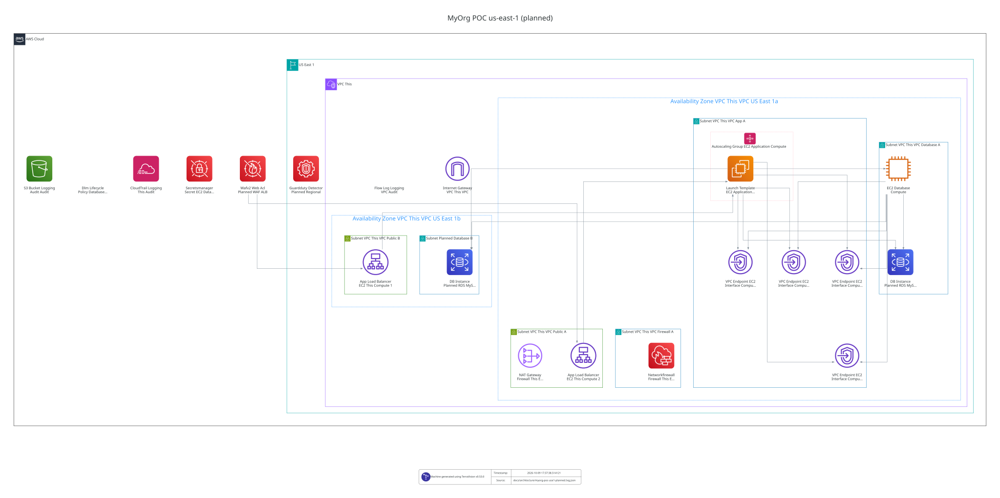

# AWS Terraform to Pulumi Example

This example uses a fictional organization called MyOrg. The three branches demonstrate infrastructure adoption, hardening, and modernization; they are not evidence of a deployed environment.

Terraform proof of concept for the MyOrg PCI-DSS network-control scenario.

The repository follows the organization-wide policy in `homel-dev/.github`. The canonical project contract is [`docs/01_architecture.md`](docs/01_architecture.md).

## Branches and evolution

This README documents the **`audit-hardening` branch**. The three branches
share the following roadmap, but each branch has its own infrastructure,
deployment instructions, and README:

| Branch | Implementation | Purpose |
| --- | --- | --- |
| `main` | Terraform, EC2 MySQL, application ASG, ALB, Network Firewall, independent Terraform states | Adopt the seeded AWS baseline and demonstrate the minimum PCI-DSS 1.3.1/1.3.2 network controls |
| `audit-hardening` | Terraform with MySQL on Multi-AZ RDS and additional encryption, backup, WAF, audit and security services | Harden the baseline and explicitly migrate the database |
| `modernized-pulumi` | Pulumi TypeScript and application containers on ECS/Fargate, using RDS | Illustrate a modernized application platform and IaC implementation |

These are architectural stages, **not** evidence that every resource exists in
the target AWS account. Each branch must be planned, applied and verified
independently. The deployment directories and commands below describe the
Terraform **`audit-hardening` target**, including its inherited `main` baseline.

**Before a real deployment:** `ec2/config/compute.yml` still includes the documentation-only ingress CIDR `203.0.113.10/32` and an account-specific imported ACM certificate ARN. Replace the CIDR with the approved client source, ensure the ACM certificate exists in the target account/region, and complete the Packer AMI prerequisite below. The checked-in POC is not a claim of PCI-DSS certification.

## Repository model

Reusable implementation lives in `modules/`. Deployment roots are identified by:

`business-unit / environment / location / stack`

For the POC, `use1` maps to AWS `us-east-1`:

```text
deployments/myorg/poc/use1/
├── terraform-state/
├── vpc/
├── iam/
├── logging/
├── route53/
├── acm/
├── firewall/
├── ec2/
├── dlm/
├── rds/
├── waf/
└── guardduty/
```

Every stack owns:

- its own Terraform root;
- its own `config/` tree;
- its own Terraform state object.

The inherited baseline modules read YAML from `${path.root}/config` and use
Terraform schema checks through `tlkamp/validation`; Route53 retains its
zone-directory model. The three added `rds`, `waf`, and `guardduty` roots
currently decode one config YAML each in their deployment root and pass values
to their modules. They **do not yet** follow the same per-YAML module
schema-validation convention. This difference is not hidden by the README.

State keys are independent:

```text
myorg/poc/use1/terraform-state/terraform.tfstate
myorg/poc/use1/vpc/terraform.tfstate
myorg/poc/use1/firewall/terraform.tfstate
myorg/poc/use1/ec2/terraform.tfstate
myorg/poc/use1/rds/terraform.tfstate
myorg/poc/use1/waf/terraform.tfstate
myorg/poc/use1/guardduty/terraform.tfstate
```

The `terraform-state` stack bootstraps the S3 bucket locally on first creation and immediately migrates its own state into its dedicated S3 key.

## Stack ordering versus Terraform dependencies

The first-deployment DAG is declared in `.github/workflows/myorg-poc-use1.yml` through GitHub Actions `needs` edges. It orders jobs without causing one Terraform root to plan or apply another root.

Cross-stack data is read explicitly with `terraform_remote_state`. For example, the firewall stack reads VPC outputs. If the VPC state already exists and has no changes, applying firewall does not apply or recreate the VPC. If the VPC state does not exist yet, the firewall plan fails because its required inputs are unavailable.

Inside one Terraform stack, normal HCL references and occasional resource-level `depends_on` are real Terraform graph edges. They control ordering inside that state only; they do not automatically recreate a dependency.

## Inherited `main` baseline

`main` includes the **manual brownfield starting point, Terraform adoption,
and minimum PCI 1.3.1/1.3.2 network controls**. The initial infrastructure
is created by `scripts/aws-brownfield-seed.sh deploy` in a **new custom POC
VPC**, not in an account's default VPC. Native Terraform import blocks in the final `poc/use1/vpc` and `poc/use1/ec2`
roots cover the seeded VPC, five subnets, routes, three security groups,
database EC2, application Launch Template/ASG, ALB, target group and HTTP/HTTPS
listeners. ACM certificates are configured in the separate `acm` root.
See [the adoption procedure](docs/02_poc_adoption.md) for
exact commands, preserved vulnerabilities, state bootstrapping, plan-review
gates and pre-import-only `destroy`.

The existing POC modules also describe the **intended network-controlled
target layout**. The final EC2 root imports the baseline and can propose the target changes
in the same reviewed plan; such changes may replace resources, including the
database EC2, and require explicit review before apply. The target layout includes:

- dedicated VPC and subnet roles;
- public HTTPS ALB with finite source allowlist;
- single application instance through ASG `1/1/1`;
- MySQL on EC2, intentionally retained for the scenario baseline;
- Network Firewall + NAT for controlled application egress;
- SSM interface endpoints for private administration;
- Route53 and ACM support;
- VPC Flow Logs, CloudTrail, ALB access logs, and firewall logs;
- DLM snapshots for the database volume;
- one S3 state object per stack;
- GitHub Actions with OIDC and pinned third-party actions;
- Packer pipelines for application and database base AMIs.

The application artifact from `example.com` remains a boot-time dependency in
the inherited EC2 implementation. It is not mirrored or baked into the
application AMI until its ownership, persistence, and customer-IP contract is
known. See [the artifact policy](docs/01_architecture.md#8-compute-boot-artifact-backup-and-encryption).

## Audit-hardening delta

This branch adds three **independent** Terraform stacks:

- **RDS** — private MySQL 8.4 on Multi-AZ RDS, a two-AZ database subnet group,
  AWS-managed KMS encryption, managed master credentials, seven-day automated
  backups, deletion protection, and narrowly scoped database access rules.
- **WAF** — regional web ACL with AWS-managed rule groups associated with the
  existing public ALB.
- **GuardDuty** — a regional detector; an existing detector must be imported
  before Terraform takes ownership.

The VPC stack adds the isolated `database-b` subnet in `us-east-1b`.
The EC2 MySQL instance and its DLM policy **remain** managed after deploying
RDS. Terraform apply does not copy database data, switch application traffic,
or decommission the old database. Follow the
[hardening and cutover runbook](docs/03_audit_hardening.md) for the reviewed
migration, rollback, and eventual separate decommission decision.

## Deployed AWS architecture

The first diagram is a checked-in snapshot rendered from Terraform state.
It does **not** establish that the current AWS account matches the snapshot.
The GitHub graph job is experimental and only runs on `main`, after selected
successful deploy paths and only when the required state objects are present.
It uses GitHub OIDC, not stored AWS access keys. A successful deployment on
`audit-hardening` does **not** update this diagram.


[Open the full-resolution AWS architecture diagram](docs/architecture/myorg-poc-use1.dot.svg)

The second diagram is a **planned overlay**: deployed baseline state plus
RDS/WAF/GuardDuty and `database-b` inferred from YAML. These planned nodes
are **not** evidence of an applied Terraform plan or running AWS resources.



[Open the full-resolution planned architecture](docs/architecture/myorg-poc-use1-planned.dot.svg)

## First deployment order

The Packer builders use the POC VPC public subnet. For an empty account, the
deployment and subsequent migration are staged as follows:

```text
1. terraform-state
2. vpc (including the new isolated database-b subnet)
3. build application + database AMIs with Packer and publish their IDs to SSM **before launching new private EC2 instances**
4. iam
5. logging
6. route53
7. acm
8. firewall
9. ec2
10. dlm
11. rds (after vpc and ec2)
12. waf (after ec2)
13. guardduty (independent after terraform-state; it can run earlier)
14. manual MySQL data migration, application cutover and verification **only after a separate review**
```

This list is a valid sequential path; the native
[location workflow](.github/workflows/myorg-poc-use1.yml) expresses the actual
parallelizable `needs` DAG. Its full deployment **does not** perform the final
manual database cutover. Check for an existing regional GuardDuty detector and
import it before attempting `full` mode.

The image workflow is separate; it must finish before a new private
application/database EC2 instance is launched. **The checked-in EC2 config
points to public Ubuntu 24.04 AMIs as an adoption fallback, not production-ready
runtime images.** Those AMIs lack the POC application service, MySQL server,
and bootstrap utilities supplied by Packer. The isolated database subnet has
no Internet route to install them at boot. Before a fresh deployment or an
import/upgrade replacing EC2 instances, build both Packer AMIs and set
`application.ami_ssm_parameter` / `database.ami_ssm_parameter` to the published
SSM paths. A successful Terraform plan does not verify boot readiness.

The order exists because downstream stacks consume outputs from already-created remote states. It is not lifecycle coupling between their states.

## GitHub Actions

GitHub Actions workflows declare their own orchestration. [`_terraform-stack.yml`](.github/workflows/_terraform-stack.yml) is the reusable implementation for one Terraform root: format/init/validate, plan to an artifact, protected-environment approval, then apply of the exact saved plan.

Required GitHub variables:

- `AWS_ROLE_ARN` — OIDC role for Terraform plan/apply;
- `AWS_IMAGE_ROLE_ARN` — OIDC role for Packer builds.
- `TF_STATE_BUCKET` — existing or to-be-created S3 state bucket, named `myorg-aws-terraform-state-<AWS-account-id>`.

`apply` uses the protected GitHub Environment `myorg-poc-use1`.

Pull requests format-check and validate every Terraform root without AWS credentials, then plan changed roots and downstream consumers against deployed remote-state outputs using OIDC. The manual `plan` and `apply` modes operate on one selected root; `full` deploys the location DAG. Each apply waits for the `myorg-poc-use1` protected GitHub Environment and consumes the plan artifact produced earlier in the same workflow run. Saved Terraform plans can contain sensitive data; artifact retention is one day. An initial `terraform-state` apply creates the bucket with local state and migrates that state to S3.

The workflow includes `rds`, `waf`, and `guardduty` in its selections, PR
filters and deployment DAG. It provisions infrastructure only; the
[database cutover](docs/03_audit_hardening.md#planned-mysql-cutover-requires-downtime)
is a separately controlled operator procedure.

Packer reads `config/image.pkrvars.hcl` directly. The image workflow validates both templates and can build either or both AMIs; builds publish their IDs to SSM. No YAML interpreter or CI driver script is involved.

## Local validation

```bash
task ci:validate
```

Validation is not deployment evidence. The acceptance tests and evidence contract live in [`docs/01_architecture.md`](docs/01_architecture.md#11-verification-and-evidence).

### One-off planned diagram

`task architecture:planned` reads the nine **deployed baseline** S3 state
objects and overlays configuration for the unapplied hardening resources.
It is a local, experimental command; it is not part of GitHub deployment.
Requires AWS CLI on `PATH`, Graphviz, Python 3 with `PyYAML`, and TerraVision
in `.venv`, for example:

```bash
python3 -m venv .venv
.venv/bin/python -m pip install PyYAML 'terravision==0.53.0'
export TF_STATE_BUCKET="myorg-aws-terraform-state-$(aws sts get-caller-identity --query Account --output text)"
task architecture:planned
```

Use `AWS_PROFILE` to select a non-default profile. The command requires read
access to all nine baseline S3 states. It creates local planned diagram data;
the resulting diagram still does not prove that RDS, WAF, or GuardDuty exist.

## Branch roadmap

- `main` — scenario baseline.
- `audit-hardening` — RDS MySQL Multi-AZ, KMS encryption, backups, GuardDuty, WAF and a reviewed database cutover ([runbook](docs/03_audit_hardening.md)).
- `modernized-pulumi` — containerized target architecture authored with Pulumi TypeScript.
