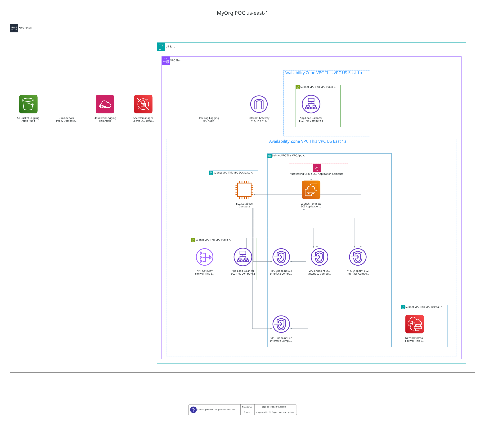

# AWS Terraform to Pulumi Example

This example uses a fictional organization called MyOrg. The three branches demonstrate infrastructure adoption, hardening, and modernization; they are not evidence of a deployed environment.

Terraform proof of concept for the MyOrg PCI-DSS network-control scenario.

The repository follows the organization-wide policy in `homel-dev/.github`. The canonical project contract is [`docs/01_architecture.md`](docs/01_architecture.md).

## Branches and evolution

This README describes the three-stage solution, and is intended to be identical in all three branches. The actual deployment code differs by branch:

| Branch | Implementation | Purpose |
| --- | --- | --- |
| `main` | Terraform, EC2 MySQL, application ASG, ALB, Network Firewall, independent Terraform states | Adopt the seeded AWS baseline and demonstrate the minimum PCI-DSS 1.3.1/1.3.2 network controls |
| `audit-hardening` | Terraform with MySQL on Multi-AZ RDS and additional encryption, backup, WAF, audit and security services | Harden the baseline and explicitly migrate the database |
| `modernized-pulumi` | Pulumi TypeScript and application containers on ECS/Fargate, using RDS | Illustrate a modernized application platform and IaC implementation |

These are architectural stages, **not** evidence that every resource exists in the target AWS account. Each branch must be planned, applied and verified independently. The deployment directories and commands below document the Terraform **`main` baseline**.

**Before a real deployment:** `ec2/config/compute.yml` still includes the documentation-only ingress CIDR `203.0.113.10/32` and an account-specific imported ACM certificate ARN. Replace the CIDR with the approved client source, ensure the ACM certificate exists in the target account/region, and complete the Packer AMI prerequisite below. The checked-in POC is not a claim of PCI-DSS certification.

## Repository model

Reusable implementation lives in `modules/`. Deployment roots are identified by:

`business-unit / environment / location / stack`

For the POC, `use1` maps to AWS `us-east-1`:

```text
deployments/myorg/poc/use1/
├── terraform-state/
├── vpc/
├── iam/
├── logging/
├── route53/
├── acm/
├── firewall/
├── ec2/
└── dlm/
```

Every stack owns:

- its own Terraform root;
- its own `config/` tree;
- its own Terraform state object.

Reusable modules read YAML from `${path.root}/config`, following the development-module pattern used as the basis for this repository. Schema errors are raised from Terraform through the `tlkamp/validation` provider; Route53 keeps the same zone-directory configuration model as the supplied development module.

State keys are independent:

```text
myorg/poc/use1/terraform-state/terraform.tfstate
myorg/poc/use1/vpc/terraform.tfstate
myorg/poc/use1/firewall/terraform.tfstate
myorg/poc/use1/ec2/terraform.tfstate
```

The `terraform-state` stack bootstraps the S3 bucket locally on first creation and immediately migrates its own state into its dedicated S3 key.

## Stack ordering versus Terraform dependencies

The first-deployment DAG is declared in `.github/workflows/myorg-poc-use1.yml` through GitHub Actions `needs` edges. It orders jobs without causing one Terraform root to plan or apply another root.

Cross-stack data is read explicitly with `terraform_remote_state`. For example, the firewall stack reads VPC outputs. If the VPC state already exists and has no changes, applying firewall does not apply or recreate the VPC. If the VPC state does not exist yet, the firewall plan fails because its required inputs are unavailable.

Inside one Terraform stack, normal HCL references and occasional resource-level `depends_on` are real Terraform graph edges. They control ordering inside that state only; they do not automatically recreate a dependency.

## Main-branch scope

`main` includes the **manual brownfield starting point, Terraform adoption,
and minimum PCI 1.3.1/1.3.2 network controls**. The initial infrastructure
is created by `scripts/aws-brownfield-seed.sh deploy` in a **new custom POC
VPC**, not in an account's default VPC. Native Terraform import blocks in the final `poc/use1/vpc` and `poc/use1/ec2`
roots cover the seeded VPC, five subnets, routes, three security groups,
database EC2, application Launch Template/ASG, ALB, target group and HTTP/HTTPS
listeners. ACM certificates are configured in the separate `acm` root.
See [the adoption procedure](docs/02_poc_adoption.md) for
exact commands, preserved vulnerabilities, state bootstrapping, plan-review
gates and pre-import-only `destroy`.

The existing POC modules also describe the **intended network-controlled
target layout**. The final EC2 root imports the baseline and can propose the target changes
in the same reviewed plan; such changes may replace resources, including the
database EC2, and require explicit review before apply. The target layout includes:

- dedicated VPC and subnet roles;
- public HTTPS ALB with finite source allowlist;
- single application instance through ASG `1/1/1`;
- MySQL on EC2, intentionally retained for the scenario baseline;
- Network Firewall + NAT for controlled application egress;
- SSM interface endpoints for private administration;
- Route53 and ACM support;
- VPC Flow Logs, CloudTrail, ALB access logs, and firewall logs;
- DLM snapshots for the database volume;
- one S3 state object per stack;
- GitHub Actions with OIDC and pinned third-party actions;
- Packer pipelines for application and database base AMIs.

The application artifact from `example.com` remains a boot-time dependency in `main`. It is not mirrored or baked into the application AMI until its ownership, persistence, and customer-IP contract is known. See [`docs/03_boot_artifact_boundary.md`](docs/03_boot_artifact_boundary.md).

## Deployed AWS architecture

The diagram below is the checked-in snapshot rendered from Terraform state data.
The `main` GitHub Actions workflow updates it after a successful deployment.
It does not establish that the **current** account still matches the snapshot.



[Open the full-resolution AWS architecture diagram](docs/architecture/myorg-poc-use1.dot.svg)

## First deployment order

The Packer builders use the POC VPC public subnet, so first deployment is intentionally staged:

```text
1. terraform-state
2. vpc
3. build application + database AMIs with Packer and publish their IDs to SSM **before launching new private EC2 instances**
4. iam
5. logging
6. route53
7. acm
8. firewall
9. ec2
10. dlm
```

The stack order is visible in [the location workflow](.github/workflows/myorg-poc-use1.yml). The image workflow is separate; it must finish before a new private application/database instance is launched. **The checked-in EC2 configuration currently points to public Ubuntu 24.04 AMIs as an adoption fallback, not production-ready runtime images.** Those AMIs lack the POC application service, MySQL server, and bootstrap utilities provided by the Packer images. The isolated database subnet has no Internet route to install them at boot. Before a fresh deployment or any import/upgrade that replaces EC2 instances, build both Packer AMIs and set `application.ami_ssm_parameter` / `database.ami_ssm_parameter` to the resulting SSM parameters. A successful Terraform plan alone does not verify boot readiness.

The order exists because downstream stacks consume outputs from already-created remote states. It is not lifecycle coupling between their states.

## GitHub Actions

GitHub Actions workflows declare their own orchestration. [`_terraform-stack.yml`](.github/workflows/_terraform-stack.yml) is the reusable implementation for one Terraform root: format/init/validate, plan to an artifact, protected-environment approval, then apply of the exact saved plan.

Required GitHub variables:

- `AWS_ROLE_ARN` — OIDC role for Terraform plan/apply;
- `AWS_IMAGE_ROLE_ARN` — OIDC role for Packer builds.
- `TF_STATE_BUCKET` — existing or to-be-created S3 state bucket, named `myorg-aws-terraform-state-<AWS-account-id>`.

`apply` uses the protected GitHub Environment `myorg-poc-use1`.

Pull requests format-check and validate every Terraform root without AWS credentials, then plan changed roots and downstream consumers against deployed remote-state outputs using OIDC. The manual `plan` and `apply` modes operate on one selected root; `full` deploys the location DAG. Each apply waits for the `myorg-poc-use1` protected GitHub Environment and consumes the plan artifact produced earlier in the same workflow run. Saved Terraform plans can contain sensitive data; artifact retention is one day. An initial `terraform-state` apply creates the bucket with local state and migrates that state to S3.

Packer reads `config/image.pkrvars.hcl` directly. The image workflow validates both templates and can build either or both AMIs; builds publish their IDs to SSM. No YAML interpreter or CI driver script is involved.

## Local validation

```bash
task ci:validate
```

Validation is not deployment evidence. The acceptance tests and evidence contract live in [`docs/01_architecture.md`](docs/01_architecture.md#11-verification-and-evidence).

## Branch roadmap

- `main` — scenario baseline.
- `audit-hardening` — RDS MySQL Multi-AZ, KMS encryption, backups, GuardDuty, WAF and a reviewed database cutover ([runbook](docs/03_audit_hardening.md)).
- `modernized-pulumi` — containerized target architecture authored with Pulumi TypeScript.
