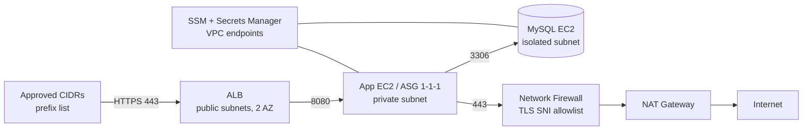

# MyOrg AWS Infrastructure POC Architecture

**Status:** Proposed implementation contract.  
**Repository:** `myorg-aws`  
**Canonical path:** `docs/01_architecture.md`

This repository follows the organization-wide policy defined by `homel-dev/.github`:

- `docs/01_engineering_style_guide.md`
- `docs/02_documentation_style_guide.md`
- `docs/03_repository_conventions.md`

Project documentation defines project-specific architecture and does not duplicate organization policy.

Normative terms are deliberate: **MUST**, **MUST NOT**, **SHOULD**, **SHOULD NOT**, and **MAY**.

## 1. Purpose and scope

The scenario is a PCI-DSS scenario. An initial internal audit found that requirements **1.3.1** (inbound traffic to the CDE) and **1.3.2** (outbound traffic from the CDE) were not covered. An external audit takes place in five days.

The starting point is a manually managed AWS environment with:

- an Internet-facing ALB with an attached certificate;
- an application EC2 instance managed through an ASG;
- MySQL running on EC2;
- default-VPC networking (three subnets);
- security groups with default outbound rules and inbound `80` from `0.0.0.0/0`;
- an external package dependency during instance bootstrap;
- an external HTTPS dependency (`secureweb.com`) during runtime;
- no Infrastructure-as-Code lifecycle.

The deliverables are:

1. a deny-by-default network control design for the CDE, with a justified rule register (section 5);
2. a Terraform POC that a reviewer can deploy **from scratch** into an empty AWS account after the documented external prerequisites are satisfied (section 6);
3. a simple diagram of the POC;
4. an interim path that can pass the audit if the final solution takes longer than five days (section 4).

Everything outside requirements 1.3.1 and 1.3.2 is out of scope for the baseline POC and listed once in section 13.

## 2. CDE definition and assumptions

The CDE boundary MUST be stated before any rule is evaluated.

| Component | Classification | Reason |
|---|---|---|
| Application EC2 instance | **In CDE** | Processes cardholder data |
| MySQL EC2 instance | **In CDE** | Stores cardholder data |
| ALB | Connected-to | Terminates TLS and forwards to the CDE |
| Network Firewall / proxy, NAT, VPC endpoints | Security-impacting | Control CDE egress and administration |

Assumptions that MUST be confirmed (see section 12):

- the application listens on TCP `8080`;
- MySQL listens on TCP `3306`;
- the DB does not need Internet access during normal operation;
- the real package repository hostname, protocol, artifact format, ownership, and persistence contract are known.

If real cardholder data is stored, encryption requirements outside 1.3.x apply and are not covered by this document. The team MUST be ready to answer questions about them.

## 3. Observed state and desired state

The current default-VPC environment is **observed state**.

The POC topology in section 6 is **desired state**.

Terraform adoption of existing resources and architectural migration MUST remain separate operations.

Importing existing infrastructure MUST NOT implicitly authorize replacement or redesign.

The POC is the primary deliverable and MUST NOT depend on the manual environment existing. Import of the existing environment is a documented procedure, not a reviewer-verifiable result.

## 4. Stage 0 — Five-day audit bridge

Stage 0 is the answer to "what if the final solution takes longer than five days". It applies to the **existing** default-VPC environment and MUST NOT require a new VPC, database migration, or containerization.

### 4.1 Principles

- Visibility comes first. Flow logs and audit logging MUST be enabled before any rule is tightened, because the real traffic is unknown.
- Tightening MUST follow observed traffic, not assumptions. Otherwise production may be broken during the audit window.
- Containment changes MAY be applied first through the AWS CLI or console as a documented emergency change, with before/after exports kept as evidence. Terraform then reconciles to the applied state. The risk reduction MUST NOT wait for a complete import.
- Import and redesign MUST NOT be combined into one change.

### 4.2 Schedule

| Day | Work |
|---|---|
| 1 | Inventory resources. Take and verify a DB snapshot. Enable VPC Flow Logs, ALB access logs, and CloudTrail. Inspect the application ASG/launch-template path and the exact boot artifact behavior. |
| 2 | Review observed flows (at least 24 hours). Finalize the rule register. Get it approved by the owner. |
| 3 | Apply containment (4.3). Keep the previous SG state exported for rollback. |
| 4 | Run verification tests (section 11). Collect evidence. Start Terraform import and reconcile. |
| 5 | Buffer, rehearsal of the audit walkthrough, and rollback readiness. |

### 4.3 Containment changes

The following MUST be applied:

- restrict ALB ingress to the approved finite CIDR list, expressed as a managed prefix list;
- terminate HTTPS at the ALB with a current TLS policy;
- close port `80` (no plaintext listener);
- restrict ALB egress to the app security group;
- allow application ingress only from the ALB security group;
- allow MySQL `3306` only from the application security group;
- remove any direct public inbound access to the database;
- restrict app and DB egress to the destinations listed in section 5;
- route the application's Internet access through a domain-allowlisting forward proxy for Stage 0, because security groups cannot filter by domain;
- retain the boot-time artifact and runtime dependencies the existing system needs to remain functional.

The following SHOULD be applied:

- SSM interface endpoints so that instances can be administered without Internet egress;
- IMDSv2 on all instances after launch-template/instance-refresh behavior has been verified.

### 4.4 Stage 0 egress design

In the default VPC, subnets are public and instances may have public IPs. Enforcement therefore relies on security groups plus the explicit forward-proxy path:

- app and DB security groups MUST NOT allow unrestricted `0.0.0.0/0` egress;
- the app security group allows egress only to the proxy security group, the DB security group, and the endpoint security group;
- the proxy allows egress TCP `443` to the Internet, limited by its domain allowlist (`secureweb.com` and the confirmed boot-artifact host).

The boot artifact MUST NOT be mirrored, persisted, or baked merely to simplify Stage 0 unless its ownership and persistence contract explicitly permits that.

### 4.5 Accepted residual risks

These MUST be written down and presented with compensating controls, not hidden.

| Risk | Compensating control |
|---|---|
| Instances remain in public subnets and may hold public IPs. | Security groups deny all unsolicited inbound traffic. Flow logs provide evidence. |
| DNS traffic to the Amazon resolver is not filtered by security groups, so DNS tunneling remains possible. | Resolver query logging; Route 53 DNS Firewall SHOULD be evaluated. |
| Domain filtering is based on proxy host/SNI visibility. Redirects/CDNs may require additional allowed domains. | Allowlist is derived from observed traffic and proxy logs are retained. |
| Existing volume encryption state may not satisfy later PCI requirements. | Verify observed state; if remediation is required, handle it as a separate encryption migration outside this baseline network-control change. |

## 5. Rule register

Default for anything not listed: **deny** (implicit deny after the explicit allow rules).

This section serves as the documented NSC standard for testing procedures **1.3.1.a** and **1.3.2.a**. The deployed configuration is the evidence for **1.3.1.b** and **1.3.2.b**.

| Field | Value |
|---|---|
| Document owner | `<name / role>` |
| Approver | `<name / role>` |
| Approval date | `<YYYY-MM-DD>` |
| Review cycle | Every 6 months and on every network change |

The justification text below is a draft. The business owner MUST confirm it.

### 5.1 Inbound traffic (1.3.1)

| ID | From → To | Port | Justification | Stage |
|---|---|---|---|---|
| IN-01 | Approved CIDR prefix list → ALB SG | TCP 443 | Customer access from a finite list of sources | S0, POC |
| IN-02 | ALB SG → App SG | TCP 8080* | ALB forwards requests to the application only | S0, POC |
| IN-03 | App SG → DB SG | TCP 3306 | Application reads and writes the database | S0, POC |
| IN-04 | Any → ALB | TCP 80 | **Denied.** No plaintext listener | S0, POC |
| IN-05 | Any → App SG / DB SG | TCP 22 | **Denied.** Administration only via SSM | S0, POC |
| IN-06 | Internet → DB SG | any | **Denied.** The DB is never reachable from the Internet | S0, POC |
| IN-07 | App SG → Proxy SG | TCP 3128 | Forward proxy for controlled Stage 0 egress | S0 only |

### 5.2 Outbound traffic (1.3.2)

| ID | From → To | Port | Justification | Stage |
|---|---|---|---|---|
| OUT-01 | ALB SG → App SG | TCP 8080* | The ALB sends traffic to the application only | S0, POC |
| OUT-02 | App SG → DB SG | TCP 3306 | Database access | S0, POC |
| OUT-03 | App SG → Proxy SG | TCP 3128 | Boot and runtime egress via the Stage 0 proxy | S0 only |
| OUT-04 | App SG → `0.0.0.0/0` | TCP 443 | POC boot/runtime HTTPS. Routing forces the path through Network Firewall; the SG alone is **not** the domain control | POC only |
| OUT-05 | App SG / DB SG → Endpoint SG | TCP 443 | SSM and Secrets Manager interface endpoints | S0, POC |
| OUT-06 | DB SG → Internet | any | **Denied.** The DB has no Internet path | S0, POC |
| OUT-07 | Proxy SG → Internet | TCP 443 | Proxy fetches only allowlisted domains | S0 only |

DNS traffic to the Amazon-provided resolver is not represented as a security-group domain rule.

### 5.3 Domain-level controls

| ID | Control | Match | Action | Justification | Stage |
|---|---|---|---|---|---|
| PX-01 | Forward-proxy ACL | `secureweb.com` | Allow | Daily operation | S0 |
| PX-02 | Forward-proxy ACL | `<boot artifact host>`** | Allow | Required artifact retrieval at boot | S0 |
| PX-03 | Forward-proxy ACL | everything else | Deny and log | Default deny | S0 |
| FW-01 | Network Firewall | TLS SNI `secureweb.com` | Allow | Daily operation | POC |
| FW-02 | Network Firewall | TLS SNI `<boot artifact host>`** | Allow | Required artifact retrieval at boot | POC |
| FW-03 | Network Firewall | everything else | Drop and log | Default deny | POC |

\* Assumed application port, to be confirmed.  
\** `example.com` is a placeholder. The real hostname, protocol, redirect behavior, ownership, and persistence contract MUST be confirmed.

## 6. POC target architecture

### 6.1 What the POC deploys

The POC deploys exactly this baseline:

- a dedicated VPC;
- one ALB, public, HTTPS only, in two Availability Zones;
- one application EC2 instance through an ASG (`min = max = desired = 1`);
- one MySQL EC2 instance;
- AWS Network Firewall for controlled application egress, with NAT;
- SSM/Secrets Manager interface endpoints;
- security groups and a managed prefix list per section 5;
- VPC Flow Logs, CloudTrail, ALB access logs, firewall logs, and DLM snapshots for the DB volume;
- optional Route 53 and ACM DNS-validation stacks when a real delegated domain is available.

A managed database and a multi-instance application tier are **not** part of `main` (section 13).



### 6.2 Subnets

The default VPC's three subnets cannot satisfy the target design. The POC uses:

- two public subnets (ALB; one also hosts NAT), one per ALB AZ;
- one private application subnet;
- one isolated database subnet with no route to the Internet;
- one firewall subnet.

To limit cost, the POC places the application, database, firewall endpoint, and NAT in one AZ. This is a documented cost trade-off and is **not** high availability.

### 6.3 Egress control choice

Security groups cannot filter by domain. Domain-level egress control therefore needs Network Firewall or a forward proxy.

| Option | Strength | Weakness |
|---|---|---|
| AWS Network Firewall | AWS-native, managed, logs | Material recurring cost. TLS domain rules depend on visible SNI and redirects/CDNs may require more domains. |
| Forward proxy | Lower infrastructure cost; explicit application-layer policy | Self-managed unless provided as a service; availability, patching, and proxy compatibility become operational responsibilities. |

`main` implements Network Firewall for the deployable POC and retains the proxy as the Stage 0 bridge.

### 6.4 Administration

Private instances MUST be administered through AWS Systems Manager. With deny-by-default egress, SSM uses private interface endpoints rather than general Internet egress.

### 6.5 Database patching

The POC database has no Internet route. Its base image therefore preinstalls MySQL. Later database lifecycle work belongs to `audit-hardening`, where MySQL moves off EC2 to a managed RDS/Aurora target.

## 7. DNS and certificates

The certificate and DNS approach depends on whether a domain is available.

**With a domain under organizational control:** Route 53 and ACM SHOULD be managed declaratively:

`Route 53 -> ACM DNS validation -> ALB HTTPS listener -> DNS alias`

**Without a domain:** the drill MAY use a self-signed certificate generated outside Terraform and imported into ACM. Terraform then references the certificate ARN. The private key MUST NOT be written to Terraform state or committed to the repository.

Actual repository and service hostnames MUST be deployment configuration. Placeholder names such as `example.com` MUST NOT be represented as production configuration.

Bootstrap traffic receives no special network exemption and MUST pass through the normal routing and security controls.

## 8. Compute, boot artifact, backup, and encryption

The initial Terraform baseline for the existing environment MUST represent what actually exists. The application stays EC2/ASG-based. MySQL stays on EC2 in `main`.

The application AMI built by Packer is a **generic base image**. It MUST NOT persist the scenario's required external boot artifact unless the artifact's ownership/cacheability contract explicitly permits that. The POC therefore preserves the boot-time retrieval and constrains the network path around it.

The database AMI MAY preinstall MySQL so that the isolated database subnet does not need general Internet access during boot.

**Backup:**

- DLM snapshots of the DB volume provide scheduled infrastructure protection but are crash-consistent;
- a restore test MUST be performed and its result recorded before the backup control is claimed as verified.

**Encryption outside the 1.3.x baseline:**

- new POC EBS volumes are encrypted;
- IMDSv2 is required on new POC instances;
- broader encryption/KMS remediation belongs to `audit-hardening`.

## 9. Secrets

Database credentials and other secrets MUST NOT be committed to Terraform configuration, user-data, repository files, or CI output.

Terraform creates secret metadata only. The database bootstrap obtains/generates the value at runtime through Secrets Manager and stores it there, so the secret value is not authored in Terraform configuration.

State MUST still be encrypted and access-controlled because provider-managed resource attributes may contain sensitive material in future changes.

## 10. Repository model, state, import, images, and CI

Deployment identity is:

`business-unit / environment / location / stack`

Every leaf stack is an independent Terraform root with its own `config/` directory and its own state.

```text
myorg-aws/
├── README.md
├── docs/
│   ├── 01_architecture.md
│   ├── 02_brownfield_adoption.md
│   └── 03_boot_artifact_boundary.md
├── modules/
│   ├── terraform-state/
│   ├── vpc/
│   ├── iam/
│   ├── logging/
│   ├── route53/
│   ├── acm/
│   ├── firewall/
│   ├── ec2/
│   └── dlm/
├── deployments/
│   └── myorg/
│       └── poc/
│           └── use1/
│               ├── ci/
│               ├── terraform-state/
│               ├── vpc/
│               ├── iam/
│               ├── logging/
│               ├── route53/
│               ├── acm/
│               ├── firewall/
│               ├── ec2/
│               └── dlm/
├── images/
│   └── myorg/poc/use1/
│       ├── application/
│       └── database/
├── .github/workflows/
├── scripts/
└── Taskfile.yml
```

Reusable infrastructure logic MUST live in `modules/`. Stack configuration MUST live below that stack's own `config/` directory; there is no location-global Terraform configuration file.

**State:** the S3 backend bucket MAY be shared, but every stack MUST use its own state object, for example:

```text
myorg/poc/use1/vpc/terraform.tfstate
myorg/poc/use1/firewall/terraform.tfstate
myorg/poc/use1/ec2/terraform.tfstate
```

The `terraform-state` stack initially uses local state only for the first bucket creation. Immediately after the bucket exists, that state MUST be migrated into its own remote object at `myorg/poc/use1/terraform-state/terraform.tfstate`. It MUST NOT share state with a workload stack.

**Import:** brownfield imports belong to the applicable leaf stack. Import identifiers MUST NOT be embedded in reusable modules. Import is a procedure to adopt the existing environment and is separate from POC deployment.

**Images:** Packer builds generic application and MySQL base AMIs. Successful builds publish the AMI IDs to SSM Parameter Store; the `ec2` stack consumes those parameter paths. The application image pipeline MUST NOT retrieve the protected boot artifact.

**CI:** GitHub requires executable workflow entry points under `.github/workflows/`. Those entry points MUST remain thin; location-specific stack registry and execution logic live under `deployments/myorg/poc/use1/ci/`. The location CI config is orchestration metadata only; it is not a Terraform resource dependency graph and does not authorize upstream recreation.

The minimum Terraform path is `fmt -> init -> validate -> plan -> reviewed apply`.

- Pull-request validation MUST NOT require AWS production credentials.
- AWS plan/apply uses GitHub OIDC and minimum practical role permissions.
- Apply uses a protected GitHub Environment/reviewer boundary.
- Third-party GitHub Actions MUST be pinned to full commit SHAs.
- A green generic workflow MUST NOT be presented as proof of deployed network behavior.

## 11. Verification and evidence

The following tests make the network-control claim verifiable. Results MUST be recorded as evidence.

| Test | Expected result |
|---|---|
| Connect to ALB `443` from an address outside the prefix list | Blocked |
| Connect to ALB `80` | Blocked |
| Connect to app or DB directly from the Internet | Blocked |
| Connect to DB `3306` from anything except the app SG | Blocked |
| From the app, request `secureweb.com` over HTTPS | Succeeds |
| From the app, request an unlisted HTTPS domain | Blocked and logged |
| From the DB, make any outbound Internet connection | Blocked |
| Launch a new application instance and observe bootstrap | Required external artifact retrieval succeeds through the controlled path and the service starts only afterward |
| Restore the DB from the latest snapshot | Succeeds; data is verified |

Evidence to preserve: exported security-group and prefix-list configuration (before and after for Stage 0), Terraform plan output, flow-log samples, proxy/firewall logs, CloudTrail records of the changes, and the approved rule register.

## 12. Acceptance, rollback, and open questions

The POC is acceptable when:

- the stack set can be deployed from an empty AWS account after documented prerequisites are satisfied;
- a second `terraform plan` for each applied stack shows no unintended changes;
- deployed security groups and firewall rules match the rule register;
- all tests in section 11 pass and their results are recorded;
- the DB has a restore-tested recovery mechanism;
- every Terraform stack has its own state;
- CI reproduces formatting, validation, planning, and reviewed apply from repository state.

Stage 0 is acceptable when:

- the containment changes in section 4.3 are applied and tested;
- accepted risks in section 4.5 are documented and approved;
- Terraform import produces no unintended destroy/recreate operations.

**Rollback:** before any destructive change, retained data MUST have a verified recovery path. Before Stage 0 containment, the previous security-group state MUST be exported. Containment changes MUST be reversible through the approved change record/repository history.

**Open questions** that change the design:

1. Which exact PCI-DSS version and assessor expectations apply?
2. Is a delegated domain available for Route 53 and ACM DNS validation?
3. What is the real boot-artifact hostname and protocol? Does it redirect to CDN/object-storage hosts?
4. Is the boot artifact allowed to be cached, mirrored, or persisted outside the customer-controlled source?
5. How many CIDR ranges are in the inbound allowlist?
6. How large is the database, and what are the RTO and RPO?
7. Does the database hold real cardholder data?
8. Is the application port really `8080`?
9. How are the existing instances administered today?
10. Does the existing ASG use a launch configuration or launch template?
11. What is the approved budget for Network Firewall versus a managed/self-operated proxy?

## 13. Out of scope and future branches

The following are explicit subsequent stages and MUST NOT be silently folded into `main`:

- `audit-hardening`: migrate MySQL from EC2 to a managed RDS/Aurora target selected from workload, RTO/RPO, availability, and cost requirements; add stronger backup/restore, encryption/KMS, security monitoring, audit evidence, WAF/GuardDuty/Config/Security Hub where justified, FinOps controls, and production hardening;
- `modernized-pulumi`: containerize the application and implement the target platform with Pulumi TypeScript, preserving the approved security and audit controls from the hardened branch;
- multi-instance, multi-AZ application availability;
- any package mirror or baked customer artifact until persistence/ownership policy explicitly permits it;
- LocalStack validation where it cannot meaningfully reproduce Network Firewall/AWS runtime behavior.
